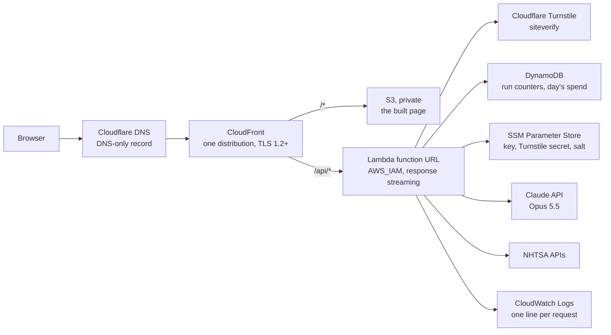

# Deploying the live demo (AWS and Cloudflare)

The live demo is a static page and one Lambda function behind one CloudFront distribution, at
`recall-desk.mniznik.com`. The infrastructure is written in Terraform and kept in a private repository, because it
carries account ids and resource names; this page describes it at the level of services. Why it is built this way:
[decision 0004](decisions/0004-lambda-streaming-behind-cloudfront.md) and
[decision 0005](decisions/0005-cheapest-refusal-first-limits.md).

## What runs where

| Piece | Service | Settings |
|---|---|---|
| Page | S3 behind CloudFront | Private bucket, all four public access blocks on, read only by this distribution through origin access control. Versioning on; old versions expire after 7 days. Hashed assets cached for a year, HTML revalidated every time. HTTP redirects to HTTPS. |
| API | Lambda function URL behind CloudFront at `/api/*` | Node.js 22, 256 MB, 60-second timeout. Function URL with `AuthType` `AWS_IAM` and invoke mode `RESPONSE_STREAM`, signed by a second origin access control. CloudFront does not cache `/api/*`, forwards every viewer header except `Host`, allows HTTPS only and waits up to 60 seconds for the origin. |
| Certificate | AWS Certificate Manager | One certificate for `recall-desk.mniznik.com`, in us-east-1 as CloudFront requires, validated by DNS. SNI, TLS 1.2 minimum. |
| Headers | CloudFront managed security headers policy | HSTS, `X-Content-Type-Options`, `X-Frame-Options`, `X-XSS-Protection`, `Referrer-Policy` (measured on the live page, 2026-11-14). No Content-Security-Policy yet. |
| Run counters | DynamoDB, on demand | One table: a counter per visitor per day, one per day, and the day's spend; items expire through TTL after 2 days. |
| Secrets | SSM Parameter Store | Three SecureString parameters under `/recall-desk/`: the Anthropic key, the Turnstile secret, the hashing salt. Read by the function at run time, re-read every 5 minutes (every minute while the key is missing). |
| Function role | IAM | Read its own parameters, decrypt them only through Parameter Store, update and read its one table, write its own log group. Nothing else. |
| Logs | CloudWatch Logs | 14 days. One JSON line per request: outcome, cost, model and tool calls, any failed rule, seconds. No question, no IP, no VIN. |
| DNS | Cloudflare | Two records, both DNS-only: the certificate's validation CNAME, and `recall-desk` pointing at the distribution. |
| Bot check | Cloudflare Turnstile | One widget for this hostname, managed mode, Free plan. |
| Typefaces | Google Fonts | Not part of this stack: each visitor's browser fetches the chosen typefaces from Google's servers ([SECURITY.md](../SECURITY.md), known gaps). |

## One live question, step by step

1. The page gets a Turnstile token from the widget, builds the request body, computes its SHA-256 in the browser
   and POSTs to `/api/ask` with the hash in `x-amz-content-sha256`.
2. CloudFront signs the request with its origin access control and forwards it to the function URL, which accepts
   only requests signed for this distribution.
3. The function reads its secrets, takes the viewer's IP from the last `X-Forwarded-For` entry (the one CloudFront
   appends), and hands everything to [src/server/ask.ts](../src/server/ask.ts): shape, Turnstile, key present,
   the day's budget, the visitor's day, the global day, then the agent on live NHTSA data.
4. Each trace event goes out as one line of JSON while the agent works; the last line carries the cost, tokens
   and seconds. After the run its cost is added to the day's spend.
5. One metadata line goes to CloudWatch Logs.

## Infrastructure as code

Terraform, in a private repository. The stack created 19 resources in 192 seconds on its first apply
(2026-11-13), without the domain; once the certificate was issued, a second apply attached the domain (1 change,
171 seconds). A plain `plan` afterwards showed no changes.

- **Guard tests.** Seven `terraform test` runs with mocked providers, so they need no credentials, assert what a
  careless edit could break: the function URL stays `AWS_IAM`; both Lambda permissions name this distribution;
  the bucket's four public access blocks stay on; HTTPS on the page and the API; no alias until the domain is
  attached, then SNI and TLS 1.2; the 60-second timeout, 14-day logs, on-demand counters with TTL. Each guard was
  seen failing: setting the URL to `NONE` and one public access block to `false` failed exactly those two runs
  (5 passed, 2 failed), and restoring them passed all 7.
- **Structure**, following AWS Prescriptive Guidance's Terraform AWS Provider best practices and HashiCorp's style
  guide (read 2026-11-13): files split by purpose (the site, the API, the role) rather than one per service; one
  input variable, because "Expose a variable only when callers have a concrete reason to change the value"; no
  modules, because "Don't wrap single resources" and there is one environment; the provider pinned to one account
  id, so a run with credentials for another account stops before changing anything; a current major version of
  the AWS provider with the lock file committed.
- **Code is not infrastructure.** Terraform creates the function with placeholder code and ignores later code
  changes; a deploy script ships the code and the page. That keeps this repository's path out of Terraform.

## Deploying a change

The deploy script, beside the Terraform, reads the bucket, distribution and function from Terraform's outputs,
then:

1. builds the page (`npm run web:build`) and the bundle (`npm run build:lambda`);
2. refuses to upload anything shaped like a credential: an Anthropic key, an AWS access key, a private key block,
   or the development key's variable name with a value;
3. syncs the page to S3 in two passes, hashed assets first with a one-year cache, HTML second so new markup never
   points at assets that are not there yet;
4. zips and uploads the function (skipped with `--page-only`);
5. invalidates CloudFront's cache.

Deploys run from the owner's machine with short-lived AWS credentials. CI has no AWS credentials and never
deploys.

## Switching the chat on and off

The Turnstile secret and the salt went into Parameter Store on 2026-11-14 without passing through a file or a log.
Live answers need the third parameter, the Anthropic key:

1. Create an Anthropic workspace for the live demo with a monthly spend limit, and a key in it. When the limit is
   reached the API answers HTTP 400 with "You have reached your specified workspace API usage limits", which the
   page shows as "this month's live budget is used up".
2. Type the key into the `/recall-desk/anthropic-key` SecureString parameter by hand.
3. While the key is missing, a warm function looks for it every minute, so within about a minute
   `GET /api/status` answers `{"live":true,...}` and the page shows the Ask tab.

To switch it off, delete that parameter: once the key is there the function re-reads every 5 minutes, so it sees
the key gone within 5 minutes and the page goes back to the recorded examples. No redeploy either way.

## Address

`mniznik.com`'s DNS is on Cloudflare. The two records are DNS-only, because a proxied record would put
Cloudflare's certificate in front of CloudFront's. The validation CNAME stays forever: the certificate's automatic
renewal needs it.

Going live, the invisible half came first: the stack without the domain; the validation record; the certificate
issued; the domain attached to the distribution; the certificate tested against a
CloudFront edge with `curl --resolve` before any DNS record existed; then the `recall-desk` record, checked on
both Cloudflare nameservers and two public resolvers. Nothing on `mniznik.com` itself changed.

## Checked on the live address

| Check | Result | When |
|---|---|---|
| The page | 200, valid certificate; HTTP redirects to HTTPS | 2026-11-13 |
| The function URL called directly | 403 | 2026-11-13 |
| `POST /api/ask` without the body hash | 403 | 2026-11-14, n=1 |
| `GET /api/status` with no key set | 200, `{"live":false,"perVisitorPerDay":5}` | 2026-11-14 |
| `POST /api/ask` with the body hash and a fake Turnstile token | 200, `application/x-ndjson`, one `bot_check` event | 2026-11-14, n=1 |
| The function's logs after it | one line, `{"outcome":"bot_check","seconds":0.5}`; no question text or IP in 15 minutes of logs | 2026-11-14 |

Not yet checked: a full live run through the public address, and so whether CloudFront passes a many-event stream
on event by event.

## Cost

AWS at demo traffic, derived from list prices for 300 live runs a month (not measured): Lambda about 2,250
GB-seconds, inside the free tier of 1 million requests and 400,000 GB-seconds a month; CloudFront well under its
free plan's 1 million requests and 100 GB; S3, DynamoDB and logs a few cents at most. The model is the cost that
matters: $0.0330 per run on average (n=6), capped at $0.30 a day by the server and by the Anthropic workspace's
monthly limit.

## Limits that shape the design

- The account allows 10 concurrent Lambda runs in all and keeps 10 unreserved, so none can be reserved for this
  function (`get-account-settings`, 2026-11-14). The chat runs at most 10 questions at once.
- A streamed run is billed for its full duration even when the visitor closes the tab (Lambda docs, quoted in
  [decision 0004](decisions/0004-lambda-streaming-behind-cloudfront.md)), hence the 60-second timeout and the
  45-second run deadline inside it.
- Turnstile tokens are single use and valid for 300 seconds, so the page asks for a fresh one after each question.
- NHTSA's terms of use and rate limits were not read. A warm function caches NHTSA replies for an hour, at most 60
  of them.

## Not done

- **Remote Terraform state.** The state is local to one machine and git-ignored. AWS recommends an S3 backend with
  locking; moving to one is a separate change.
- **Static analysis of the Terraform** (a linter and a security scanner) is not set up.
- **A Content-Security-Policy header** ([SECURITY.md](../SECURITY.md), known gaps).
